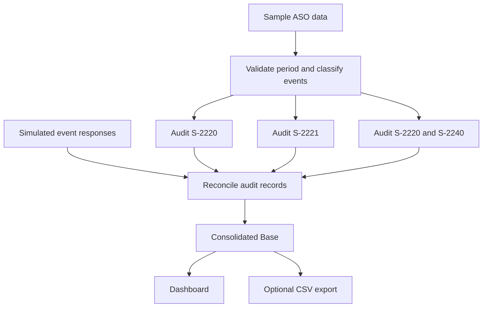

<div align="center">

# 🩺 eSocial Audit Automation

**💼 Professional Context**  
**Google Apps Script & JavaScript | Occupational Audit Workflow Demo**

[](https://developer.mozilla.org/en-US/docs/Web/JavaScript)
[](https://developers.google.com/apps-script)
[](https://www.google.com/sheets/about/)
[](https://nodejs.org/)


**A runnable, standalone portfolio demonstration with synthetic data only.**

</div>

---

## 📌 About the Project

This project draws on challenges encountered while working with **occupational health and eSocial audit processes in a professional setting**. It is **not a university assignment**. The repository presents an independent **Google Sheets + Apps Script** prototype illustrating data processing, event-result reconciliation, and audit performance tracking.

This portfolio implementation demonstrates applied knowledge of **JavaScript, data processing, workflow automation, data reconciliation, and reporting**. Its code was created specifically as a standalone demonstration: **it is not the company's original operational system and does not reproduce private integrations or workflows**.

> **Demonstration only:** fictional employers, fictional employees, invented receipts, and simulated return statuses. No real external service connection, production credentials, external endpoints, or private business code.

---

## ⚙️ Features

- **Weekly audit generation:** current week (Sunday–Saturday), considering records dated up to today.
- **Monthly audit generation:** from the first day of the current month through today.
- **Illustrative event routing:** `S-2220`, `S-2221` and `S-2240`, with separate or combined audit tabs.
- **Synthetic response reconciliation:** accepted, pending, rejected, and reprocessing states.
- **Manual treatment:** editable notes and status, without erasing existing notes on reprocessing.
- **Idempotent generation:** prevents duplicate records for the same period, fictional ID and event.
- **Consolidated base:** unifies audit event records in a single worksheet.
- **Dashboard:** counts by event, treatment status and inconsistency.
- **CSV export:** optional export of the fictitious consolidated data to the user's Drive.

The logic is **illustrative rather than normative**; it must not be used for actual legal or occupational compliance decisions.

---

## 🛠️ Tech Stack

| Technology | Application |
|:---|:---|
| **JavaScript (ES6)** | Classification, date handling, data normalization and reconciliation |
| **Google Apps Script (V8)** | Custom menus and spreadsheet automation |
| **Google Sheets** | Synthetic input, audit records, reporting and dashboard |
| **Node.js** | Dependency-free logic and simulated workflow tests |

---

## 🔄 How It Works



All sample data is generated locally inside the Google Sheet. No external API is queried.

---

## 🚀 Getting Started

1. Create a **new, empty Google Sheet** for testing.
2. Open **Extensions → Apps Script**.
3. Create one script file for each `.gs` file in [`src/`](src) and paste in its contents (the `.gs` files are Apps Script source code, not Google Drive documents).
4. Save the project and refresh the spreadsheet.
5. Select **Auditoria Demo → Preparar estrutura demonstrativa**.
6. Run **Gerar auditoria semanal** or **Gerar auditoria mensal**.
7. Open **DASHBOARD**, **BASE GERAL**, and the audit tabs to explore the sample results.
8. Edit a record in **RETORNOS SIMULADOS** and run **Atualizar retornos simulados** to see reconciliation in action.

Google may request access to both Sheets and Drive during authorization because the project includes an optional CSV export function, even if you do not run that function.

For screenshots-free, step-by-step instructions in Portuguese, see [**Como executar**](docs/COMO_EXECUTAR.md).

To run the local tests:

```bash
npm test
```

This repository does not include an online hosted demo: Apps Script executes within a Google Sheet created by the user.

---

## 📁 Repository Structure

```text
esocial-audit-automation/
├── src/
│   ├── Config.gs
│   ├── Logica.gs
│   ├── DadosFicticios.gs
│   ├── Planilhas.gs
│   ├── Auditoria.gs
│   ├── Retornos.gs
│   ├── Dashboard.gs
│   ├── Menu.gs
│   └── appsscript.json
├── docs/
│   ├── ARCHITECTURE.md
│   └── COMO_EXECUTAR.md
├── tests/
│   ├── logic.test.js
│   └── workflow.test.js
├── SECURITY.md
├── package.json
├── .gitignore
└── README.md
```

---

## 🧪 What Is Simulated?

The `ENTRADA ASO` worksheet contains made-up record IDs, employers, people, examination types and dates. `RETORNOS SIMULADOS` contains invented event states and `REC-DEMO-*` receipt labels.

**Not included:** real employee records, production integrations, company-specific rule engines, service keys, client identifiers, source documentation, private workflows or an operational eSocial audit system.

Read [**technical decisions**](docs/ARCHITECTURE.md) and [**security notes**](SECURITY.md) before adapting this example.
